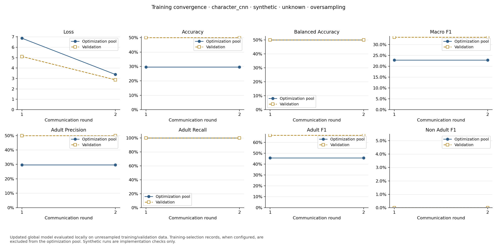
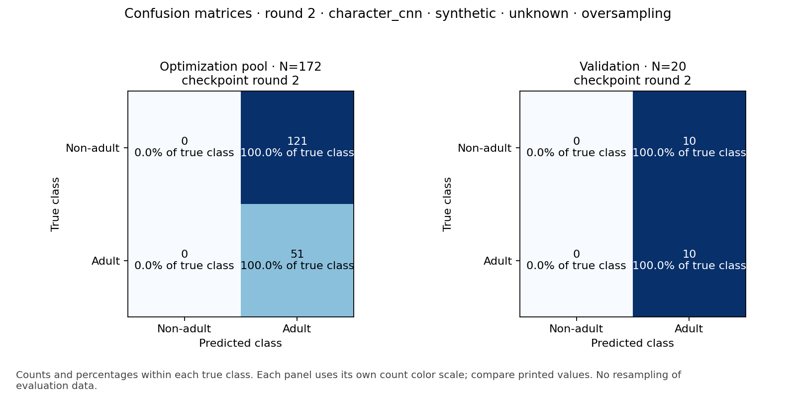
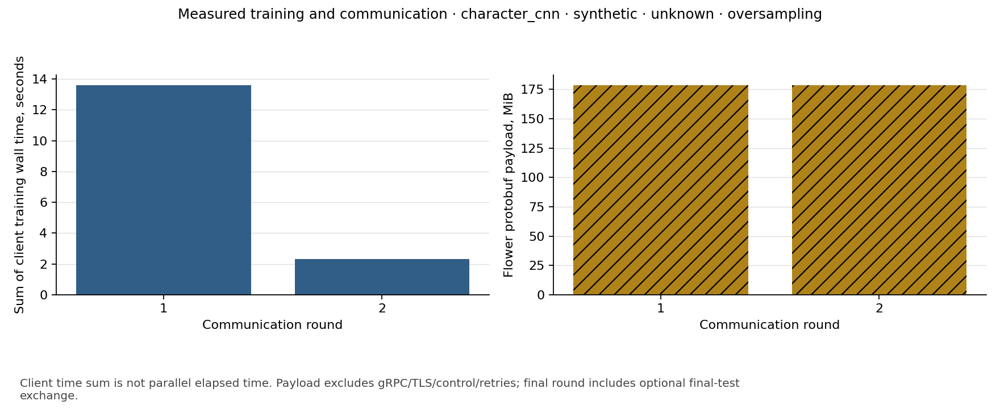

# Evaluation and comparison results

No method is declared best. Validation and final test measurements are reported separately; single-seed results and convergence warnings limit conclusions.

Numerical rows pool predictions from independent local numerical models. Flower rows describe a shared federated model. Synthetic smoke results are not real-data evidence.

Recorded numerical fit warnings: **0**. Counts are retained per method/scenario in report.json; warnings are not hidden or used to retune against holdouts.

Encoder-embedding rows use training-only encoder warmup and a frozen-encoder balanced head phase; they are a distinct protocol from end-to-end training. Never interpolate raw strings or token IDs.

With training-only checkpoint selection, train metrics exclude the selection pool. The test is measured once after the FL budget on the selected checkpoint; its checkpoint round may differ from the final communication round. Per-experiment selection metadata and checkpoint hashes/rounds are retained in report.json.

## All requested classification metrics

| Family / data / protocol | Partition | Method | Split / round | Adult P | Adult R | Adult F1 | Non-adult P | Non-adult R | Non-adult F1 | Macro-F1 | Balanced accuracy | Accuracy | N |
|---|---|---|---|---:|---:|---:|---:|---:|---:|---:|---:|---:|---:|
| character_cnn / synthetic / end_to_end | unknown | oversampling | train / 1 | 0.2965 | 1.0000 | 0.4574 | 0.0000 | 0.0000 | 0.0000 | 0.2287 | 0.5000 | 0.2965 | 172 |
| character_cnn / synthetic / end_to_end | unknown | oversampling | val / 1 | 0.5000 | 1.0000 | 0.6667 | 0.0000 | 0.0000 | 0.0000 | 0.3333 | 0.5000 | 0.5000 | 20 |
| character_cnn / synthetic / end_to_end | unknown | oversampling | train / 2 | 0.2965 | 1.0000 | 0.4574 | 0.0000 | 0.0000 | 0.0000 | 0.2287 | 0.5000 | 0.2965 | 172 |
| character_cnn / synthetic / end_to_end | unknown | oversampling | val / 2 | 0.5000 | 1.0000 | 0.6667 | 0.0000 | 0.0000 | 0.0000 | 0.3333 | 0.5000 | 0.5000 | 20 |

Confusion matrices, class supports, prevalence, source hashes, exact configuration, timing and communication measurements are retained in report.json. Undefined class ratios use zero; macro-F1 and balanced recall use the fixed two-class label set.

## Confusion matrices

True rows and predicted columns use [Non-adult, Adult].

| Family / data | Partition | Method | Split / round | TN | FP | FN | TP |
|---|---|---|---|---:|---:|---:|---:|
| character_cnn / synthetic / end_to_end | unknown | oversampling | train / 1 | 0 | 121 | 0 | 51 |
| character_cnn / synthetic / end_to_end | unknown | oversampling | val / 1 | 0 | 10 | 0 | 10 |
| character_cnn / synthetic / end_to_end | unknown | oversampling | train / 2 | 0 | 121 | 0 | 51 |
| character_cnn / synthetic / end_to_end | unknown | oversampling | val / 2 | 0 | 10 | 0 | 10 |

## Timing and communication

One row per experiment/round, not repeated for each metric split. Missing measurements are not zeros.

| Family / data | Partition | Method | Round | Sum client training seconds | Total local elapsed seconds | Round wall seconds | Protobuf payload MiB |
|---|---|---|---|---:|---:|---:|---:|
| character_cnn / synthetic / end_to_end | unknown | oversampling | 1 | 13.599 | not recorded | 21.181 | 178.618 |
| character_cnn / synthetic / end_to_end | unknown | oversampling | 2 | 2.319 | not recorded | 9.642 | 178.618 |

## Figures

## Measurement limits

- Existing real-data results are single-seed numerical experiments, not CNN/DeBERTa FL performance.
- Neural real-data comparisons remain not measured until those experiments run; synthetic smoke is never substituted.
- Convergence warnings are preserved. Single-seed measured validation/test results do not establish a robust best method.
- Historical elapsed times include training/evaluation/audits; separate training time is null where it was not recorded.
- Local numerical runs have no federated communication measurement. Historical missing timing/bytes remain null, not zero.
- Flower byte counts cover serialized application payloads including chunk staging/fetch RPCs; they exclude registration, gRPC/TLS framing and retries.
- Global train metrics use unresampled local optimization pools, excluding training-selection records when configured; optimization loss uses balanced views and is distinct.
- Per-class undefined divisions use zero; macro-F1/balanced recall average the fixed [Non-adult, Adult] label set.
- Data minimization is not differential privacy or secure aggregation; only counts and model states cross the FL API.
- A declared cross-partition population label is not proof of identical membership; retain the preprocessing leakage/coverage audit.

## Real-data experiment coverage

| Family | Partition | Method | Validation | Final test | Status |
|---|---|---|---|---|---|
| engineered_numeric | iid | undersampling | not measured | not measured | not measured |
| engineered_numeric | iid | oversampling | not measured | not measured | not measured |
| engineered_numeric | iid | smote | not measured | not measured | not measured |
| engineered_numeric | iid | ensemble_undersampling | not measured | not measured | not measured |
| engineered_numeric | label_skew | undersampling | not measured | not measured | not measured |
| engineered_numeric | label_skew | oversampling | not measured | not measured | not measured |
| engineered_numeric | label_skew | smote | not measured | not measured | not measured |
| engineered_numeric | label_skew | ensemble_undersampling | not measured | not measured | not measured |
| engineered_numeric | category_skew | undersampling | not measured | not measured | not measured |
| engineered_numeric | category_skew | oversampling | not measured | not measured | not measured |
| engineered_numeric | category_skew | smote | not measured | not measured | not measured |
| engineered_numeric | category_skew | ensemble_undersampling | not measured | not measured | not measured |
| character_cnn | iid | undersampling | not measured | not measured | not measured |
| character_cnn | iid | oversampling | not measured | not measured | not measured |
| character_cnn | iid | smote | not measured | not measured | not measured |
| character_cnn | iid | ensemble_undersampling | not measured | not measured | not measured |
| character_cnn | label_skew | undersampling | not measured | not measured | not measured |
| character_cnn | label_skew | oversampling | not measured | not measured | not measured |
| character_cnn | label_skew | smote | not measured | not measured | not measured |
| character_cnn | label_skew | ensemble_undersampling | not measured | not measured | not measured |
| character_cnn | category_skew | undersampling | not measured | not measured | not measured |
| character_cnn | category_skew | oversampling | not measured | not measured | not measured |
| character_cnn | category_skew | smote | not measured | not measured | not measured |
| character_cnn | category_skew | ensemble_undersampling | not measured | not measured | not measured |
| deberta_v3_base | iid | undersampling | not measured | not measured | not measured |
| deberta_v3_base | iid | oversampling | not measured | not measured | not measured |
| deberta_v3_base | iid | smote | not measured | not measured | not measured |
| deberta_v3_base | iid | ensemble_undersampling | not measured | not measured | not measured |
| deberta_v3_base | label_skew | undersampling | not measured | not measured | not measured |
| deberta_v3_base | label_skew | oversampling | not measured | not measured | not measured |
| deberta_v3_base | label_skew | smote | not measured | not measured | not measured |
| deberta_v3_base | label_skew | ensemble_undersampling | not measured | not measured | not measured |
| deberta_v3_base | category_skew | undersampling | not measured | not measured | not measured |
| deberta_v3_base | category_skew | oversampling | not measured | not measured | not measured |
| deberta_v3_base | category_skew | smote | not measured | not measured | not measured |
| deberta_v3_base | category_skew | ensemble_undersampling | not measured | not measured | not measured |
