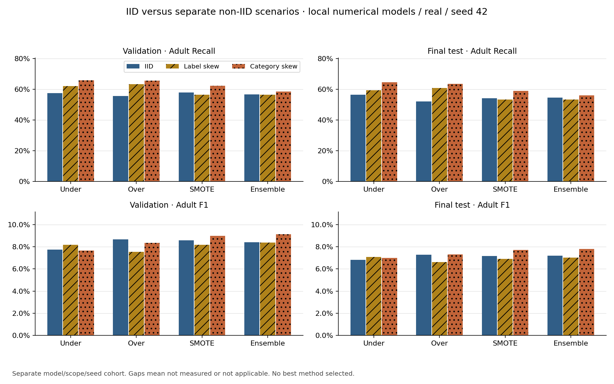
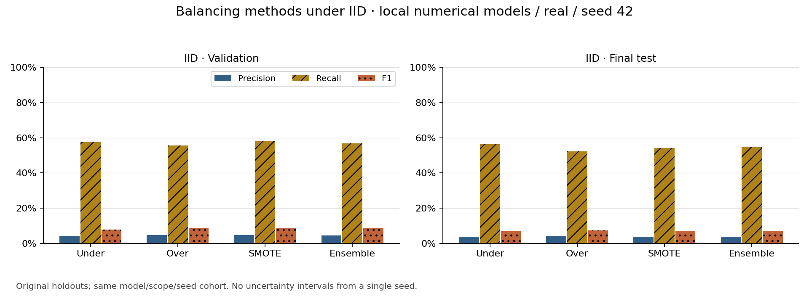
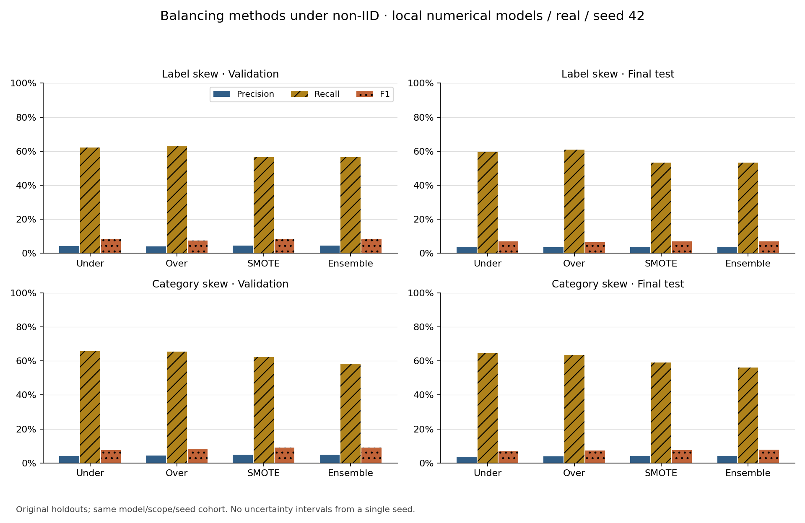
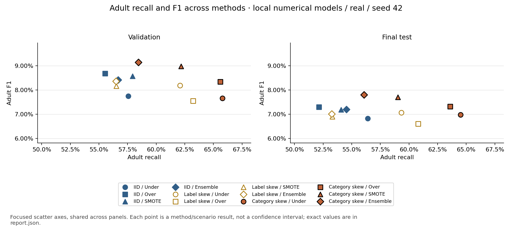
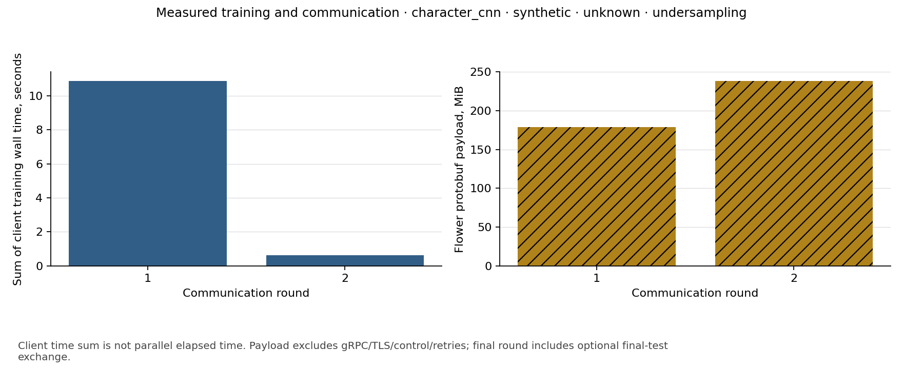

# Evaluation and comparison results

No method is declared best. Validation and final test measurements are reported separately; single-seed results and convergence warnings limit conclusions.

Numerical rows pool predictions from independent local numerical models. Flower rows describe a shared federated model. Synthetic smoke results are not real-data evidence.

Recorded numerical fit warnings: **74**. Counts are retained per method/scenario in report.json; warnings are not hidden or used to retune against holdouts.

## All requested classification metrics

| Family / data | Partition | Method | Split / round | Adult P | Adult R | Adult F1 | Non-adult P | Non-adult R | Non-adult F1 | Macro-F1 | Balanced accuracy | Accuracy | N |
|---|---|---|---|---:|---:|---:|---:|---:|---:|---:|---:|---:|---:|
| engineered_numeric / real | category_skew | ensemble_undersampling | val / local | 0.0496 | 0.5845 | 0.0915 | 0.9855 | 0.7160 | 0.8294 | 0.4604 | 0.6502 | 0.7127 | 194,640 |
| engineered_numeric / real | category_skew | ensemble_undersampling | test / local | 0.0419 | 0.5607 | 0.0780 | 0.9860 | 0.7064 | 0.8231 | 0.4506 | 0.6336 | 0.7032 | 216,894 |
| engineered_numeric / real | category_skew | oversampling | val / local | 0.0445 | 0.6559 | 0.0834 | 0.9866 | 0.6430 | 0.7786 | 0.4310 | 0.6495 | 0.6433 | 194,640 |
| engineered_numeric / real | category_skew | oversampling | test / local | 0.0388 | 0.6359 | 0.0732 | 0.9871 | 0.6395 | 0.7761 | 0.4247 | 0.6377 | 0.6394 | 216,894 |
| engineered_numeric / real | category_skew | smote | val / local | 0.0484 | 0.6217 | 0.0898 | 0.9863 | 0.6898 | 0.8118 | 0.4508 | 0.6557 | 0.6881 | 194,640 |
| engineered_numeric / real | category_skew | smote | test / local | 0.0412 | 0.5902 | 0.0771 | 0.9865 | 0.6855 | 0.8089 | 0.4430 | 0.6378 | 0.6834 | 216,894 |
| engineered_numeric / real | category_skew | undersampling | val / local | 0.0407 | 0.6578 | 0.0766 | 0.9859 | 0.6064 | 0.7509 | 0.4138 | 0.6321 | 0.6076 | 194,640 |
| engineered_numeric / real | category_skew | undersampling | test / local | 0.0369 | 0.6449 | 0.0698 | 0.9869 | 0.6144 | 0.7574 | 0.4136 | 0.6297 | 0.6151 | 216,894 |
| engineered_numeric / real | iid | ensemble_undersampling | val / local | 0.0455 | 0.5669 | 0.0842 | 0.9845 | 0.6983 | 0.8170 | 0.4506 | 0.6326 | 0.6950 | 194,640 |
| engineered_numeric / real | iid | ensemble_undersampling | test / local | 0.0385 | 0.5453 | 0.0720 | 0.9851 | 0.6883 | 0.8104 | 0.4412 | 0.6168 | 0.6851 | 216,894 |
| engineered_numeric / real | iid | oversampling | val / local | 0.0471 | 0.5554 | 0.0869 | 0.9845 | 0.7150 | 0.8284 | 0.4576 | 0.6352 | 0.7111 | 194,640 |
| engineered_numeric / real | iid | oversampling | test / local | 0.0392 | 0.5214 | 0.0730 | 0.9847 | 0.7074 | 0.8233 | 0.4481 | 0.6144 | 0.7032 | 216,894 |
| engineered_numeric / real | iid | smote | val / local | 0.0463 | 0.5793 | 0.0857 | 0.9849 | 0.6972 | 0.8165 | 0.4511 | 0.6383 | 0.6943 | 194,640 |
| engineered_numeric / real | iid | smote | test / local | 0.0385 | 0.5406 | 0.0718 | 0.9850 | 0.6905 | 0.8119 | 0.4419 | 0.6155 | 0.6872 | 216,894 |
| engineered_numeric / real | iid | undersampling | val / local | 0.0416 | 0.5756 | 0.0775 | 0.9840 | 0.6633 | 0.7924 | 0.4350 | 0.6194 | 0.6611 | 194,640 |
| engineered_numeric / real | iid | undersampling | test / local | 0.0363 | 0.5640 | 0.0683 | 0.9850 | 0.6572 | 0.7884 | 0.4283 | 0.6106 | 0.6551 | 216,894 |
| engineered_numeric / real | label_skew | ensemble_undersampling | val / local | 0.0452 | 0.5650 | 0.0837 | 0.9844 | 0.6972 | 0.8163 | 0.4500 | 0.6311 | 0.6939 | 194,640 |
| engineered_numeric / real | label_skew | ensemble_undersampling | test / local | 0.0376 | 0.5325 | 0.0702 | 0.9847 | 0.6873 | 0.8095 | 0.4398 | 0.6099 | 0.6838 | 216,894 |
| engineered_numeric / real | label_skew | oversampling | val / local | 0.0401 | 0.6323 | 0.0755 | 0.9851 | 0.6163 | 0.7583 | 0.4169 | 0.6243 | 0.6167 | 194,640 |
| engineered_numeric / real | label_skew | oversampling | test / local | 0.0349 | 0.6081 | 0.0661 | 0.9856 | 0.6153 | 0.7576 | 0.4118 | 0.6117 | 0.6151 | 216,894 |
| engineered_numeric / real | label_skew | smote | val / local | 0.0440 | 0.5652 | 0.0817 | 0.9842 | 0.6886 | 0.8103 | 0.4460 | 0.6269 | 0.6855 | 194,640 |
| engineered_numeric / real | label_skew | smote | test / local | 0.0369 | 0.5329 | 0.0690 | 0.9845 | 0.6814 | 0.8054 | 0.4372 | 0.6072 | 0.6781 | 216,894 |
| engineered_numeric / real | label_skew | undersampling | val / local | 0.0439 | 0.6208 | 0.0820 | 0.9856 | 0.6567 | 0.7882 | 0.4351 | 0.6388 | 0.6558 | 194,640 |
| engineered_numeric / real | label_skew | undersampling | test / local | 0.0376 | 0.5932 | 0.0707 | 0.9859 | 0.6522 | 0.7851 | 0.4279 | 0.6227 | 0.6509 | 216,894 |
| character_cnn / synthetic | unknown | undersampling | train / 1 | 0.3390 | 1.0000 | 0.5063 | 1.0000 | 0.0250 | 0.0488 | 0.2776 | 0.5125 | 0.3500 | 60 |
| character_cnn / synthetic | unknown | undersampling | val / 1 | 0.5000 | 0.9000 | 0.6429 | 0.5000 | 0.1000 | 0.1667 | 0.4048 | 0.5000 | 0.5000 | 20 |
| character_cnn / synthetic | unknown | undersampling | train / 2 | 0.0000 | 0.0000 | 0.0000 | 0.6667 | 1.0000 | 0.8000 | 0.4000 | 0.5000 | 0.6667 | 60 |
| character_cnn / synthetic | unknown | undersampling | val / 2 | 0.0000 | 0.0000 | 0.0000 | 0.5000 | 1.0000 | 0.6667 | 0.3333 | 0.5000 | 0.5000 | 20 |
| character_cnn / synthetic | unknown | undersampling | test / 2 | 0.0000 | 0.0000 | 0.0000 | 0.5000 | 1.0000 | 0.6667 | 0.3333 | 0.5000 | 0.5000 | 20 |

Confusion matrices, class supports, prevalence, source hashes, exact configuration, timing and communication measurements are retained in report.json. Undefined class ratios use zero; macro-F1 and balanced recall use the fixed two-class label set.

## Confusion matrices

True rows and predicted columns use [Non-adult, Adult].

| Family / data | Partition | Method | Split / round | TN | FP | FN | TP |
|---|---|---|---|---:|---:|---:|---:|
| engineered_numeric / real | category_skew | ensemble_undersampling | val / local | 135,911 | 53,913 | 2,001 | 2,815 |
| engineered_numeric / real | category_skew | ensemble_undersampling | test / local | 149,790 | 62,246 | 2,134 | 2,724 |
| engineered_numeric / real | category_skew | oversampling | val / local | 122,053 | 67,771 | 1,657 | 3,159 |
| engineered_numeric / real | category_skew | oversampling | test / local | 135,592 | 76,444 | 1,769 | 3,089 |
| engineered_numeric / real | category_skew | smote | val / local | 130,942 | 58,882 | 1,822 | 2,994 |
| engineered_numeric / real | category_skew | smote | test / local | 145,358 | 66,678 | 1,991 | 2,867 |
| engineered_numeric / real | category_skew | undersampling | val / local | 115,104 | 74,720 | 1,648 | 3,168 |
| engineered_numeric / real | category_skew | undersampling | test / local | 130,280 | 81,756 | 1,725 | 3,133 |
| engineered_numeric / real | iid | ensemble_undersampling | val / local | 132,549 | 57,275 | 2,086 | 2,730 |
| engineered_numeric / real | iid | ensemble_undersampling | test / local | 145,939 | 66,097 | 2,209 | 2,649 |
| engineered_numeric / real | iid | oversampling | val / local | 135,726 | 54,098 | 2,141 | 2,675 |
| engineered_numeric / real | iid | oversampling | test / local | 149,987 | 62,049 | 2,325 | 2,533 |
| engineered_numeric / real | iid | smote | val / local | 132,350 | 57,474 | 2,026 | 2,790 |
| engineered_numeric / real | iid | smote | test / local | 146,414 | 65,622 | 2,232 | 2,626 |
| engineered_numeric / real | iid | undersampling | val / local | 125,911 | 63,913 | 2,044 | 2,772 |
| engineered_numeric / real | iid | undersampling | test / local | 139,354 | 72,682 | 2,118 | 2,740 |
| engineered_numeric / real | label_skew | ensemble_undersampling | val / local | 132,349 | 57,475 | 2,095 | 2,721 |
| engineered_numeric / real | label_skew | ensemble_undersampling | test / local | 145,734 | 66,302 | 2,271 | 2,587 |
| engineered_numeric / real | label_skew | oversampling | val / local | 116,996 | 72,828 | 1,771 | 3,045 |
| engineered_numeric / real | label_skew | oversampling | test / local | 130,458 | 81,578 | 1,904 | 2,954 |
| engineered_numeric / real | label_skew | smote | val / local | 130,710 | 59,114 | 2,094 | 2,722 |
| engineered_numeric / real | label_skew | smote | test / local | 144,485 | 67,551 | 2,269 | 2,589 |
| engineered_numeric / real | label_skew | undersampling | val / local | 124,661 | 65,163 | 1,826 | 2,990 |
| engineered_numeric / real | label_skew | undersampling | test / local | 138,290 | 73,746 | 1,976 | 2,882 |
| character_cnn / synthetic | unknown | undersampling | train / 1 | 1 | 39 | 0 | 20 |
| character_cnn / synthetic | unknown | undersampling | val / 1 | 1 | 9 | 1 | 9 |
| character_cnn / synthetic | unknown | undersampling | train / 2 | 40 | 0 | 20 | 0 |
| character_cnn / synthetic | unknown | undersampling | val / 2 | 10 | 0 | 10 | 0 |
| character_cnn / synthetic | unknown | undersampling | test / 2 | 10 | 0 | 10 | 0 |

## Timing and communication

One row per experiment/round, not repeated for each metric split. Missing measurements are not zeros.

| Family / data | Partition | Method | Round | Sum client training seconds | Total local elapsed seconds | Round wall seconds | Protobuf payload MiB |
|---|---|---|---|---:|---:|---:|---:|
| engineered_numeric / real | category_skew | ensemble_undersampling | local | not recorded | 5.232 | not recorded | not recorded |
| engineered_numeric / real | category_skew | oversampling | local | not recorded | 9.751 | not recorded | not recorded |
| engineered_numeric / real | category_skew | smote | local | not recorded | 10.737 | not recorded | not recorded |
| engineered_numeric / real | category_skew | undersampling | local | not recorded | 1.356 | not recorded | not recorded |
| engineered_numeric / real | iid | ensemble_undersampling | local | not recorded | 10.301 | not recorded | not recorded |
| engineered_numeric / real | iid | oversampling | local | not recorded | 16.500 | not recorded | not recorded |
| engineered_numeric / real | iid | smote | local | not recorded | 19.053 | not recorded | not recorded |
| engineered_numeric / real | iid | undersampling | local | not recorded | 3.075 | not recorded | not recorded |
| engineered_numeric / real | label_skew | ensemble_undersampling | local | not recorded | 4.489 | not recorded | not recorded |
| engineered_numeric / real | label_skew | oversampling | local | not recorded | 8.896 | not recorded | not recorded |
| engineered_numeric / real | label_skew | smote | local | not recorded | 10.524 | not recorded | not recorded |
| engineered_numeric / real | label_skew | undersampling | local | not recorded | 1.371 | not recorded | not recorded |
| character_cnn / synthetic | unknown | undersampling | 1 | 10.871 | not recorded | 14.471 | 178.599 |
| character_cnn / synthetic | unknown | undersampling | 2 | 0.627 | not recorded | 4.061 | 238.132 |

## Figures

## Measurement limits

- Existing real-data results are single-seed numerical experiments, not CNN/DeBERTa FL performance.
- Neural real-data comparisons remain not measured until those experiments run; synthetic smoke is never substituted.
- Convergence warnings are preserved. Single-seed measured validation/test results do not establish a robust best method.
- Historical elapsed times include training/evaluation/audits; separate training time is null where it was not recorded.
- Local numerical runs have no federated communication measurement. Historical missing timing/bytes remain null, not zero.
- Flower byte counts cover serialized application protobuf payloads, not gRPC/TLS framing, control messages or retries.
- Global train metrics use original local training splits, evaluated after aggregation; optimization loss uses balanced views and is distinct.
- Per-class undefined divisions use zero; macro-F1/balanced recall average the fixed [Non-adult, Adult] label set.
- Data minimization is not differential privacy or secure aggregation; only counts and model states cross the FL API.
- A declared cross-partition population label is not proof of identical membership; retain the preprocessing leakage/coverage audit.

## Real-data experiment coverage

| Family | Partition | Method | Validation | Final test | Status |
|---|---|---|---|---|---|
| engineered_numeric | iid | undersampling | measured | measured | measured |
| engineered_numeric | iid | oversampling | measured | measured | measured |
| engineered_numeric | iid | smote | measured | measured | measured |
| engineered_numeric | iid | ensemble_undersampling | measured | measured | measured |
| engineered_numeric | label_skew | undersampling | measured | measured | measured |
| engineered_numeric | label_skew | oversampling | measured | measured | measured |
| engineered_numeric | label_skew | smote | measured | measured | measured |
| engineered_numeric | label_skew | ensemble_undersampling | measured | measured | measured |
| engineered_numeric | category_skew | undersampling | measured | measured | measured |
| engineered_numeric | category_skew | oversampling | measured | measured | measured |
| engineered_numeric | category_skew | smote | measured | measured | measured |
| engineered_numeric | category_skew | ensemble_undersampling | measured | measured | measured |
| character_cnn | iid | undersampling | not measured | not measured | not measured |
| character_cnn | iid | oversampling | not measured | not measured | not measured |
| character_cnn | iid | smote | not measured | not measured | not applicable in this implementation |
| character_cnn | iid | ensemble_undersampling | not measured | not measured | not measured |
| character_cnn | label_skew | undersampling | not measured | not measured | not measured |
| character_cnn | label_skew | oversampling | not measured | not measured | not measured |
| character_cnn | label_skew | smote | not measured | not measured | not applicable in this implementation |
| character_cnn | label_skew | ensemble_undersampling | not measured | not measured | not measured |
| character_cnn | category_skew | undersampling | not measured | not measured | not measured |
| character_cnn | category_skew | oversampling | not measured | not measured | not measured |
| character_cnn | category_skew | smote | not measured | not measured | not applicable in this implementation |
| character_cnn | category_skew | ensemble_undersampling | not measured | not measured | not measured |
| deberta_v3_base | iid | undersampling | not measured | not measured | not measured |
| deberta_v3_base | iid | oversampling | not measured | not measured | not measured |
| deberta_v3_base | iid | smote | not measured | not measured | not applicable in this implementation |
| deberta_v3_base | iid | ensemble_undersampling | not measured | not measured | not applicable in this implementation |
| deberta_v3_base | label_skew | undersampling | not measured | not measured | not measured |
| deberta_v3_base | label_skew | oversampling | not measured | not measured | not measured |
| deberta_v3_base | label_skew | smote | not measured | not measured | not applicable in this implementation |
| deberta_v3_base | label_skew | ensemble_undersampling | not measured | not measured | not applicable in this implementation |
| deberta_v3_base | category_skew | undersampling | not measured | not measured | not measured |
| deberta_v3_base | category_skew | oversampling | not measured | not measured | not measured |
| deberta_v3_base | category_skew | smote | not measured | not measured | not applicable in this implementation |
| deberta_v3_base | category_skew | ensemble_undersampling | not measured | not measured | not applicable in this implementation |
